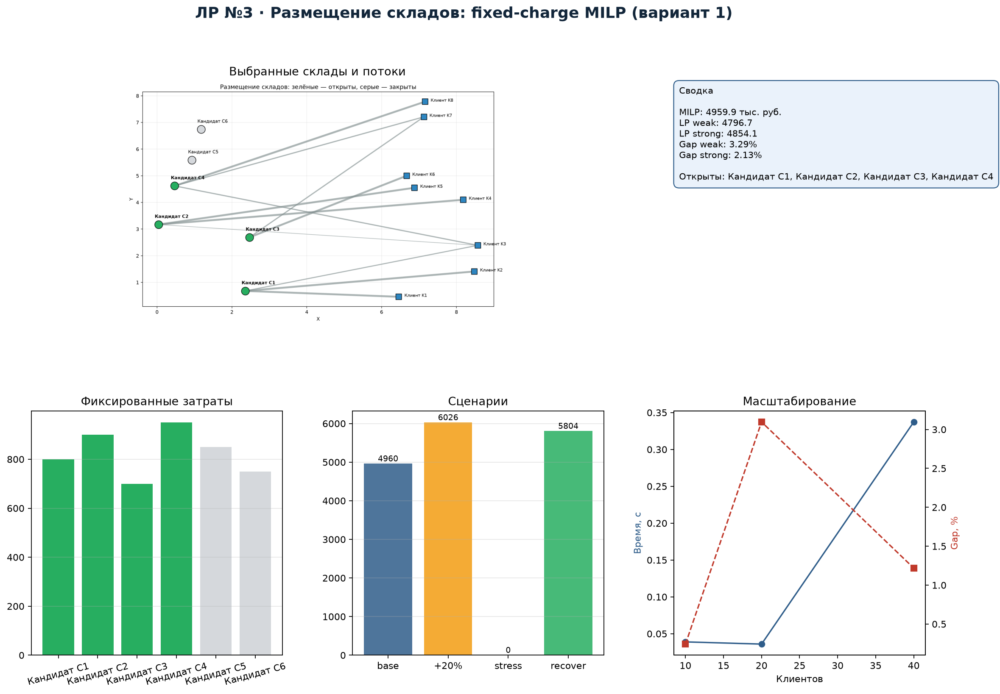
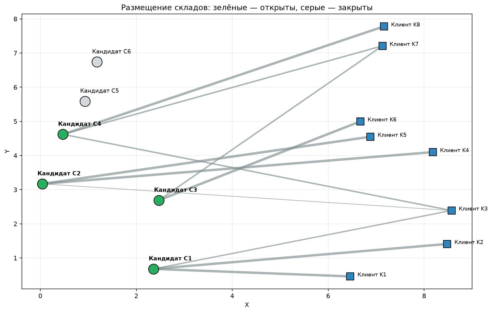
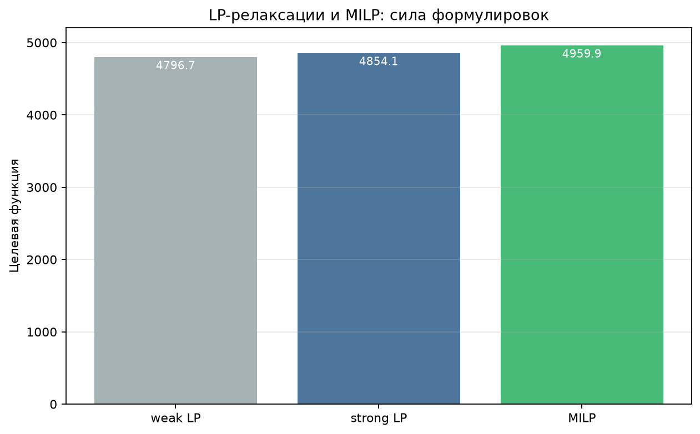
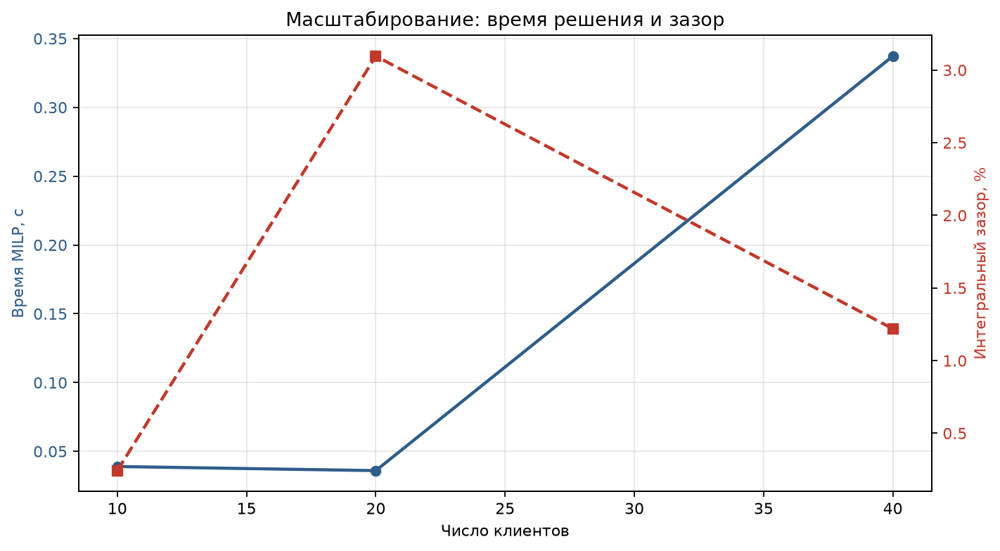
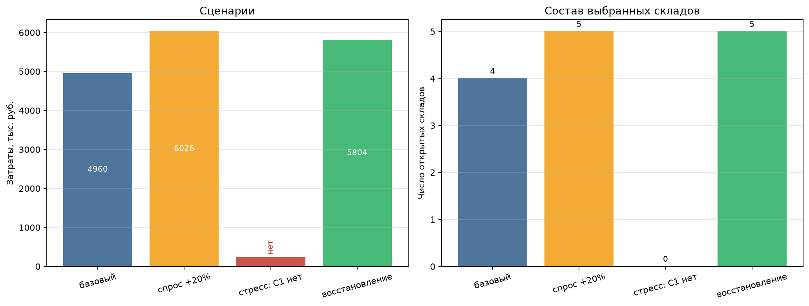

# Лабораторная работа №3
## MILP-модель дискретного выбора: размещение складов


**Студент:** Якимов Максим Андреевич  
**Группа:** Б24-517, № 31  
**Вариант:** 1  
**Дисциплина:** «Методы оптимизации. Линейное программирование»

---

## Дашборд



## Постановка задачи

Facility location: 6 кандидатов, 8 клиентов. Выбрать открываемые склады и
распределить клиентов, минимизируя фиксированные затраты открытия и
транспортные затраты.

$$\min \sum_i f_i y_i + \sum_i\sum_j c_{ij}x_{ij}$$

при ограничениях

$$\sum_i x_{ij}=d_j,\qquad \sum_j x_{ij}\le q_i y_i,\qquad
y_i\in\{0,1\},\ x_{ij}\ge0.$$

Данные — `data/candidates.csv`, `data/clients.csv`, `data/transport.csv`,
seed `10131`.

## Результат

**Открыты C1, C2, C3, C4. Затраты — 4959.85 тыс. руб.** Проверка: нарушения
спроса, мощности и бинарности равны 0.

### LP-релаксация и big-M

| Формулировка | LP | MILP | Gap |
|---|---:|---:|---:|
| Слабая | 4796.75 | 4959.85 | 3.29 % |
| **Сильная** | 4854.12 | 4959.85 | **2.13 %** |

Сильная формулировка добавляет $x_{ij}\le d_j y_i$ и сокращает зазор.

## Сценарии

| Сценарий | Затраты | Открыты |
|---|---:|---|
| Базовый | 4959.85 | C1, C2, C3, C4 |
| Спрос +20 % | 6026.50 | C1, C2, C3, C4, C6 |
| Стресс: спрос +30 %, C1 недоступен | infeasible, дефицит 53 | — |
| Восстановление: C1 недоступен | 5803.85 | C2, C3, C4, C5, C6 |

Жадная эвристика: 5117.60 (зазор 3.18 %). Масштабирование: 4×10, 6×20,
8×40 — время MILP 0.012, 0.015, 0.087 с, зазор 0.24–3.10 %.

## Графики

| Карта складов | Формулировки |
|---|---|
|  |  |

| Масштабирование | Сценарии |
|---|---|
|  |  |

## Запуск

```bash
pip install -r requirements.txt
python generate_data.py
python main.py
```

Выход: `results/lab3_solution.csv`, `lab3_formulations.csv`,
`lab3_scenarios.csv`, `lab3_greedy.csv`, `lab3_scaling.csv`, `solver.log`.

## Состав сдаваемых материалов

| Требование ТЗ | Файл |
|---|---|
| Исходный код | `main.py`, `generate_data.py` |
| README с установкой и запуском | `README.md` |
| Отчёт PDF / Markdown | `report.pdf`, `report.md` |
| Данные варианта и описание генерации | `data/candidates.csv`, `data/clients.csv`, `data/transport.csv`, `data/README.md` |
| Лог солвера | `results/solver.log` |
| Таблица найденного решения | `results/lab3_solution.csv` |
| Независимая проверка | `results/verification.csv` |
| Сценарные эксперименты | `results/lab3_scenarios.csv` |
| Графики и схемы | `results/lab3_dashboard.png`, `lab3_map.png`, `lab3_formulations.png`, `lab3_scaling.png`, `lab3_scenarios.png` |

## Отчёт

Готовый PDF: [`report.pdf`](report.pdf). Исходник: [`report.md`](report.md).
