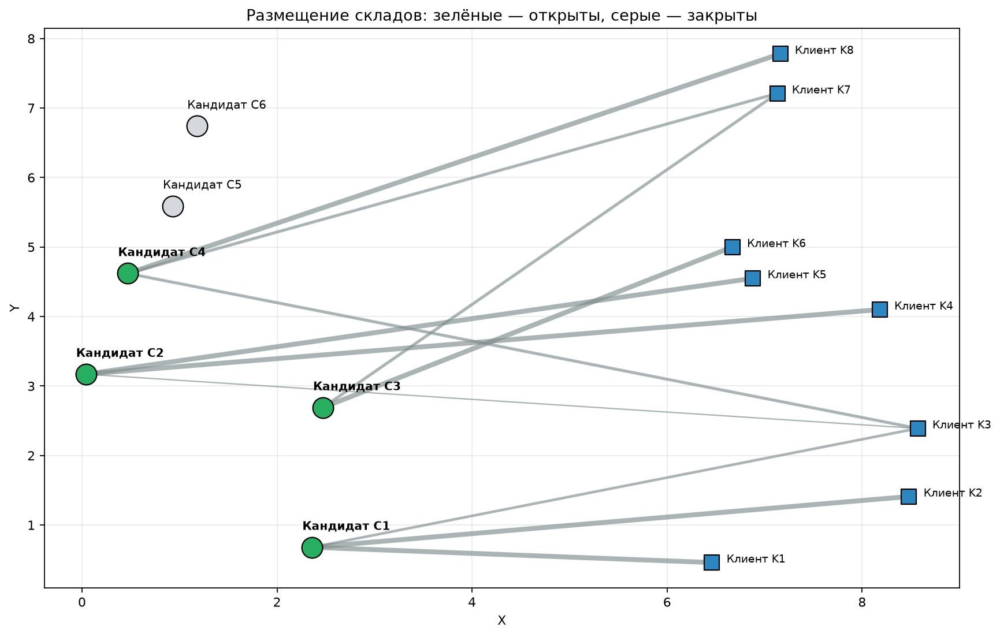
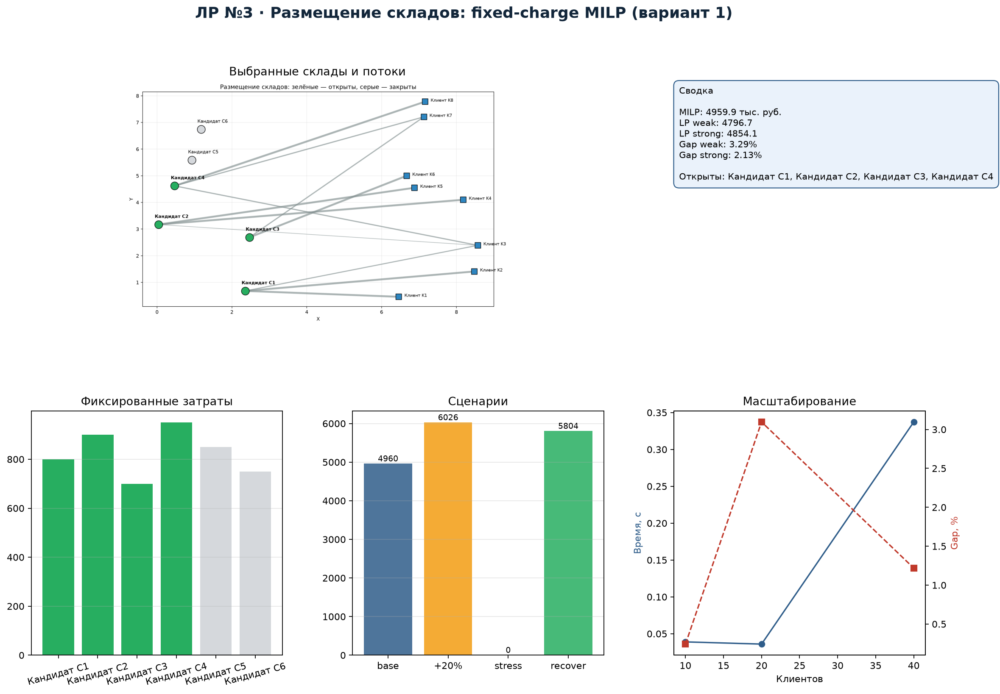
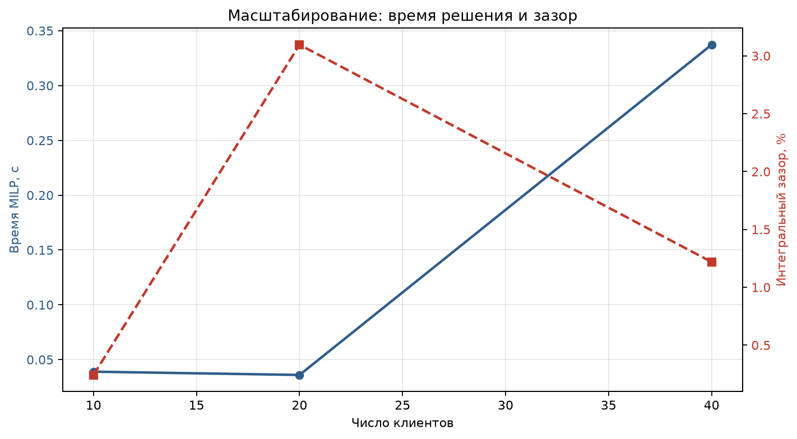

# 1. Постановка задачи и вариант

**Вариант:** 1 — размещение складов (facility location): фиксированные
затраты открытия + транспортные затраты. Минимальный масштаб: 6 кандидатов,
8 клиентов.

Требуется выбрать, какие склады открыть, и распределить клиентов так, чтобы
минимизировать сумму фиксированных затрат на открытие и транспортных затрат.

# 2. Формальная MILP-модель

**Множества:** кандидаты $i\in C=\{1,\ldots,6\}$; клиенты $j\in K=\{1,\ldots,8\}$.

**Параметры:**

| Обозначение | Смысл | Единица |
|---|---|---|
| $f_i$ | фиксированная стоимость открытия | тыс. руб. |
| $q_i$ | мощность склада | ед. |
| $d_j$ | спрос клиента | ед. |
| $c_{ij}$ | транспортные затраты | тыс. руб./ед. |

**Переменные:**

- $y_i\in\{0,1\}$ — склад $i$ открыт;
- $x_{ij}\ge 0$ — поток от склада $i$ клиенту $j$.

**Целевая функция:**
$$\min \sum_{i} f_i y_i + \sum_{i}\sum_{j} c_{ij}x_{ij}.$$

**Ограничения:**
$$\sum_i x_{ij}=d_j\ \ \forall j;\qquad
\sum_j x_{ij}\le q_i y_i\ \ \forall i;\qquad
x_{ij}\ge 0,\ y_i\in\{0,1\}.$$

Это классическая fixed-charge модель: бинарные $y_i$ включают фиксированные
затраты, а связка $\sum_j x_{ij}\le q_i y_i$ не позволяет потоку идти через
закрытый склад. Именно эта связка является big-M-ограничением с
$M_i=q_i$.

# 3. Формулировки и сила LP-релаксации

Реализованы две формулировки:

1. **Слабая:** только агрегированная связка $\sum_j x_{ij}\le q_i y_i$.
2. **Сильная:** дополнительно $x_{ij}\le d_j y_i$ для каждой пары
   «склад–клиент».

Сильная формулировка запрещает даже частичный поток через закрытый склад,
поэтому её LP-релаксация ближе к MILP.

| Формулировка | LP-релаксация | MILP | Интегральный зазор |
|---|---:|---:|---:|
| Слабая | 4796.75 | 4959.85 | 3.29 % |
| Сильная | 4854.12 | 4959.85 | **2.13 %** |

Обе LP-релаксации дают нижнюю оценку; сильная формулировка сокращает зазор
на 1.16 п.п. Это подтверждает, что выбор big-M-связок влияет на скорость
ветвления и качество границы.

# 4. Результат

Задача решена HiGHS через `scipy.optimize.milp`: branch-and-bound с LP-
релаксациями, presolve включён, допуск $10^{-6}$; LP-релаксации решаются
тем же HiGHS. Лог сохранён в `results/solver.log`. Оптимальное решение:
открыты склады **C1, C2, C3, C4**; суммарные затраты — **4959.85 тыс. руб.**
Независимая проверка: нарушения спроса, мощности и бинарности равны 0;
построчные результаты — в `results/verification.csv`.

# 5. Сценарии

| Сценарий | Статус | Затраты | Открыты | Недопоставка |
|---|---|---:|---|---:|
| Базовый | optimal | 4959.85 | C1, C2, C3, C4 | 0 |
| Спрос +20 % | optimal | 6026.50 | C1, C2, C3, C4, C6 | 0 |
| Стресс: спрос +30 %, C1 недоступен | infeasible | — | — | 53 |
| Восстановление: C1 недоступен, базовый спрос | optimal | 5803.85 | C2, C3, C4, C5, C6 | 0 |

В дефицитном сценарии рост спроса на 20 % заставляет открыть пятый склад C6
и увеличивает затраты на 21.5 %. В стрессовом сценарии спрос 533 ед., а
доступная мощность без C1 — 480 ед.; минимальная недопоставка 53 ед.
(эластичный/диагностический расчёт). Если C1 недоступен, но спрос базовый,
сеть перестраивается на C2–C6 и работает с затратами 5803.85.

# 6. Сравнение с жадной эвристикой

Жадная эвристика открывает склады по score $f_i/q_i+\overline{c_i}$ и
назначает клиентов по возрастанию стоимости. Она даёт 5117.60 тыс. руб. —
на 3.18 % выше MILP. Жадность не учитывает совместный эффект фиксированных
затрат и транспортных потоков, поэтому проигрывает оптимуму.

# 7. Масштабирование: время и зазор

| Кандидатов × клиентов | LP, тыс. руб. | MILP, тыс. руб. | Время MILP, с | Зазор, % |
|---|---:|---:|---:|---:|
| 4 × 10 | 4103.55 | 4113.53 | 0.012 | 0.24 |
| 6 × 20 | 6811.95 | 7029.60 | 0.015 | 3.10 |
| 8 × 40 | 10303.07 | 10430.18 | 0.087 | 1.22 |

С ростом размерности время решения растёт, а зазор зависит от структуры
экземпляра. Для 40 клиентов MILP всё ещё решается за доли секунды, поскольку
бинарных переменных только 8; рост числа бинарных переменных был бы
существенно дороже.

# 8. О big-M

В слабой формулировке $M_i=q_i$ — это максимальный поток через склад. Если
взять $M$ неоправданно большим (например, $10q_i$), LP-релаксация станет
слабее: при дробных $y_i$ через «полуоткрытый» склад можно провести больше
потока, и зазор вырастет. Сильная формулировка с $x_{ij}\le d_j y_i$
ограничивает каждый поток спросом клиента и даёт более tight-релаксацию.
Поэтому big-M нужно выбирать как можно меньше, но не меньше реальной
верхней границы переменной.

# 9. Практическая реализуемость и ограничения модели

Решение можно реализовать на практике, если известны фиксированные затраты,
мощности и транспортные тарифы. Основные ограничения:

- фиксированные затраты считаются постоянными и не зависят от масштаба;
- мощности и спрос детерминированы, без сезонных колебаний;
- не учитываются дискретность грузопотоков и неделимые партии;
- транспортные затраты линейны и не зависят от загрузки маршрута.

Для реального проекта потребовались бы стохастические сценарии спроса,
ограничения по срокам и более детальная модель транспортных тарифов.
Тем не менее модель корректно отвечает на стратегический вопрос: какие
склады открывать и как распределять клиентов.

# 10. Вывод

1. Построена и решена MILP-модель размещения складов; оптимум — 4959.85
   тыс. руб. при открытии C1–C4.
2. Сильная big-M-формулировка уменьшает интегральный зазор с 3.29 % до
   2.13 %; это quantitatively подтверждает важность формулировки.
3. Сценарии показывают, что рост спроса приводит к открытию дополнительного
   склада, а потеря C1 при высоком спросе делает систему недопустимой
   (дефицит 53 ед.).
4. Жадная эвристика проигрывает MILP на 3.18 %, что оправдывает применение
   точной модели.
